# 芯声智向作品技术报告

[下载PDF](design_report.pdf) · [下载Word](design_report.docx)

芯声智向多通道声源定位增强系统

持续声源定位与声像显示设计报告

## 摘要

本作品面向室内声源方向显示，设计16通道MEMS麦克风阵列与Zynq-7020处理平台，并将定位结果叠加到USB摄像头画面。早期单次定位链路虽已打通，逐子帧前端处理间隔91.8709 ms仍超过52.4288 ms输入周期，导致采集缓冲耗尽。为此，系统采用20帧PCM环和最新四帧独立快照，分别推进连续采集、定位与UDP发送；PL以分时抽取和共享存储组织频谱及空间计算，PS管理任务交接，Qt按结果身份与有效期更新方向和声像。历史连续调度基线实板输出62条结果，平均计算470.889 ms，Qt平均更新间隔470.339 ms，566帧16路PCM完整接收。设计将单次计算链转为持续采集条件下的周期性方向输出，并在同一硬件上扩展前半球扫描和局部渐变声像显示。

## 第一部分  作品概述

### 1.1 功能与特性

系统能够连续采集16路音频，给出当前主导声源的方位角和板面俯仰角，并显示通道波形。定位页用深蓝底小圆点标出方向；摄像头页把方向标记叠加到实时画面上，标记大小可以调整。软件提供连接、开始和停止操作，同次上电后可反复启停。每条结果带有运行轮次、采样区间和序号，过期或无效结果会清除。系统保留完整空间响应供叠加与诊断使用，当前一次报告一个主导方向。

### 1.2 选题背景与应用价值

摄像头能记录场景，却不能单独说明声音来自哪里。在教学实验、会议观察和设备噪声排查中，声像结合便于使用者找到发声区域。本作品设计16路圆形阵列，由Zynq计算方向，再传给上位机叠加显示，无需预先识别声音类别。

广义相关与PHAT奠定了多通道时延估计基础[1]，SRP通过累加通道对证据确定方向[2]。后续研究改进了空间采样、搜索与跟踪[3,4]，FPGA实现强调并行度与资源复用的权衡[5,6]。在定位算法基础上，嵌入式系统还需协调计算、采集和通信的节拍。

早期系统能够完成单次定位，但每52.4288 ms就有新音频子帧到达，前端完成间隔却为91.8709 ms，最终耗尽采集槽。本文据此研究：如何在保留连续16路音频的同时，使定位计算不再长期占用采集缓冲，并周期性更新方向。设计以采集完整性、显示更新间隔和硬件开销验证数据流调整的效果。

### 1.3 主要技术特点

设计按数据占用时间划分任务：DMA帧分片复制至20帧PCM环后及时归还，定位使用最新连续四帧独立快照，RAW发送按包推进；PL以分时抽取、共享FFT工作存储和独立空间扫描核控制资源开销。24频带及四帧一致性判断方向质量，运行序号、采样区间与有效期约束显示。前半球配置复用325个扫描槽，覆盖方位0～360°、板面俯仰0～90°，共289条独立射线。

### 1.4 主要性能指标

| 指标 | 参数或实测值 |
| --- | --- |
| 平台与音频 | Zynq-7020；16路；39062.5 Hz；2048点/帧 |
| 当前扫描 | 前半球325槽/289射线；15°/7.5°网格 |
| 连续调度基线更新 | 计算470.889 ms；Qt间隔470.339 ms |
| 首次方向显示 | 1789.910 ms；含预热与首组取窗计算 |
| 软件功能 | 手动启停、方向与波形、USB声像叠加 |

### 1.5 主要创新点

（1）针对多通道资源紧张，以16路分时抽取和64 KiB共享存储减少重复实例；整机BRAM占用136/140。

（2）针对91.87 ms处理慢于52.43 ms输入，采用20帧PCM环与四帧快照；历史实测566帧完整接收，Qt约470 ms更新。

（3）针对无效峰和旧包干扰，结合24频带、四帧一致性与序号时效校验；实测拒绝14条低质量结果，保留48条有效方向。

### 1.6 设计流程

设计先完成阵列、采集与单次定位，再用阶段时间戳定位持续运行中的缓冲瓶颈；随后改为PCM环、独立快照和分阶段调度，接入Qt声像显示。验证沿数值一致性、接口交接、固定输入计时、连续采集与启停展开，分别统计接收帧数、分析覆盖、显示间隔及资源占用。图1给出调度改进与历史实板对照。

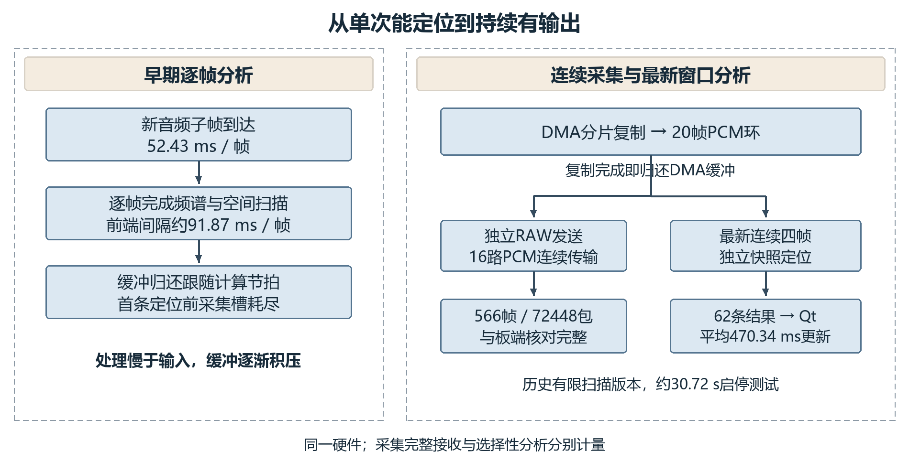

图1 从逐帧分析到持续定位的数据流改进与历史实板对照

## 第二部分  系统组成及功能说明

### 2.1 整体介绍

系统由麦克风阵列、Zynq处理平台和PC上位机组成。阵列提供16路同步音频，Zynq完成采集、频谱与空间响应计算，通过UDP发送方向、响应和原始PCM。USB摄像头直接接入PC，Qt将视频与声学方向合并显示。定位结果计算完成即进入发送队列，PC侧承担显示及后续音频处理。

工程按源码、验证、构建、板端运行、数据、技能包和报告组织目录[7]。前半球配置与连续调度基线共用硬件；基线采用有限范围5°网格，前半球配置采用15°/7.5°网格。第三部分分别列出运行计时、接收完整性和硬件实现结果。

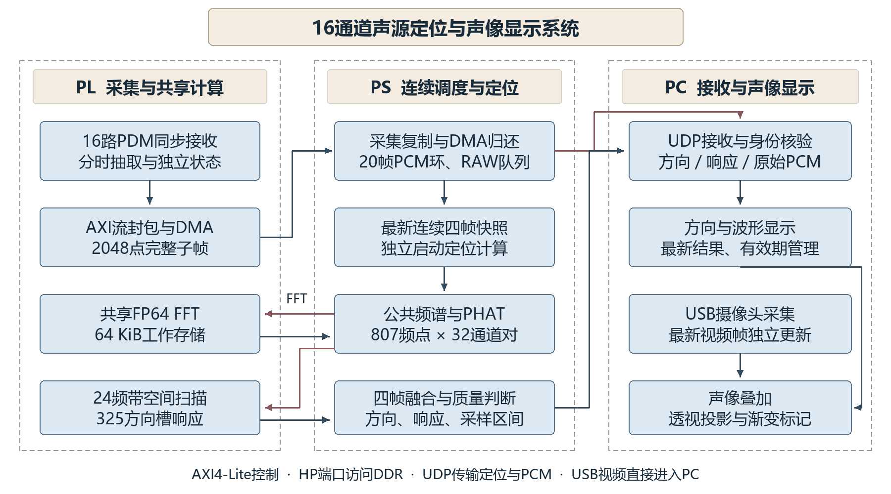

图2 系统模块与消息流

### 2.2 硬件系统介绍

#### 2.2.1 硬件整体介绍

计算平台采用AC880开发板，核心器件为xc7z020clg484-2，片内包含Cortex-A9处理系统和FPGA可编程逻辑。阵列由16颗MP34DT05TR-A数字MEMS麦克风组成，设计半径80 mm，相邻麦克风间隔22.5°。阵列通过16路DATA和1路共享CLK接入板卡，电源、地与信号按功能转接，麦克风参数依据原厂资料[8]。

硬件沿用已完成布局布线的纯音频工程。PDM接收、抽取和DMA在PL中持续工作，FFT与扫描核由多个任务分时使用；PS管理数据缓冲和任务状态。相机改为PC直连后，板端不再承担OV5640与HDMI视频处理。互连和DMA接口参考Zynq及AXI DMA文档[9,10]。

BD中，AXI4-Lite承担寄存器控制，AXI高性能端口承担DDR数据访问，AXI4-Stream只用于采集数据流。音频PL、FIFO、DMA与PS构成采集主链；共享计算IP通过DDR读写任务数据。下图保留Vivado导出的连线，随后按实际执行路径重画任务映射，便于看清模块用途。

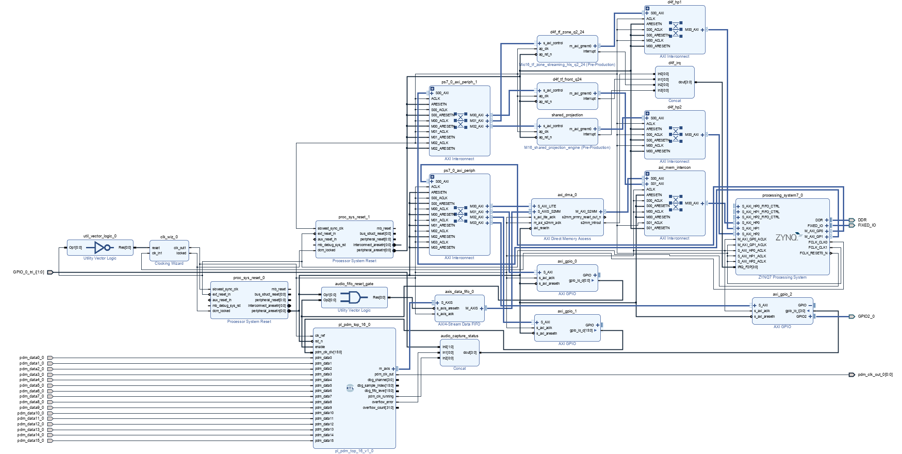

图3 纯音频数据流工程的Vivado Block Design

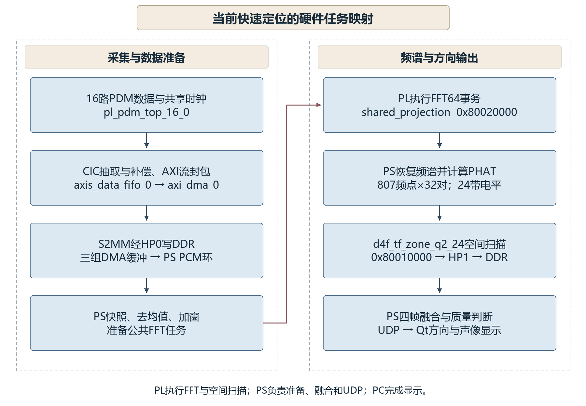

图4 当前快速定位的硬件任务映射

#### 2.2.2 机械设计介绍

阵列竖直安装。从声源一侧正对阵列观察，MIC0在上、MIC4在左、MIC8在下、MIC12在右。本文以MIC12为方位0°，沿MIC0、MIC4、MIC8依次为90°、180°和270°；俯仰从PCB平面起算，沿板面为0°，正前方为90°。正对阵列法线时，方位角没有定义，界面显示“—”。

USB相机模组固定在阵列正面靠近中心的位置，开发板与阵列通过连接线相连。使用时保持相机和阵列的相对位置不变。镜像、视场和画面偏移用于调整图像投影，角度读数由独立的阵列安装记录换算。移动相机或转动阵列后，需要重新检查对齐。

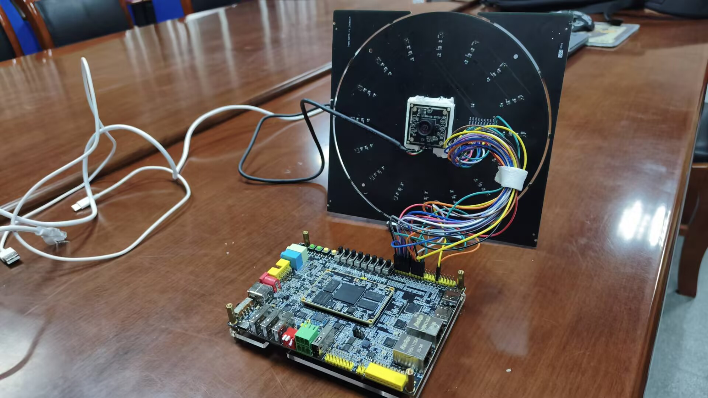

图5 开发板、阵列与USB摄像头的固定安装

#### 2.2.3 电路各模块介绍

麦克风前端采用3.3 V供电，每路布置去耦电容，16路数据线使用同一个PDM时钟。PL参考时钟为100 MHz，分频后产生2.5 MHz PDM时钟，经64倍抽取得到39062.5 Hz PCM。接收与CIC抽取后的数据封装为AXI4-Stream，由DMA写入DDR；PS每收到一个2048点完整子帧，完成归一化并送入PCM环。

数据在各级缓冲中按顺序交接。采集模块持有DMA槽，复制完成后立即归还；PCM环保存连续样本；定位任务独占自己的四帧快照；发送队列保存等待UDP发送的帧。CPU与设备交接DDR数据时执行相应Cache清理、失效和屏障操作，防止读取旧缓存或覆盖尚未使用的数据。

| 模块 | 关键输入 | 关键输出或约束 |
| --- | --- | --- |
| 阵列与时钟 | 3.3 V、GND；CLK输入 | 16路DATA；MIC的L/R接地；时钟串联22 Ω |
| PDM与抽取 | 100 MHz参考、16路PDM | 2.5 MHz PDM时钟；64倍抽取、CIC补偿 |
| AXIS FIFO与DMA | tdata/tvalid/tready/tlast | S2MM经HP0写DDR；中断回报完成 |
| 共享FP64引擎 | 0x80020000；DDR arena、job描述 | 本快速路径的FFT64；经HP2交接 |
| 空间扫描核 | 0x80010000；807频点×32对PHAT | 24×325 F32响应；经HP1交接 |
| 控制与复位 | AXI-Lite、GPIO、reset/locked | 配置、采集状态与FIFO局部复位 |

阵列采用3.3 V供电，输入处设置10 μF电容，各麦克风附近配置0.1 μF去耦及局部1 μF储能电容。L/R引脚统一接地，使各路采用相同的数据有效半周期。每个麦克风各占一根DATA线，输出经0 Ω电阻引到连接器；0 Ω位置便于通道排查和后续改板。

16路共用一根PDM时钟，时钟入口串联22 Ω电阻后送至各麦克风，减轻快速边沿引起的振铃。DATA、CLK和电源地按信号功能与开发板连接，PL端配置为3.3 V数字I/O。前端输出是同步PDM位流，抽取和滤波在FPGA内完成，电路中无需为16路分别配置模拟放大与ADC。

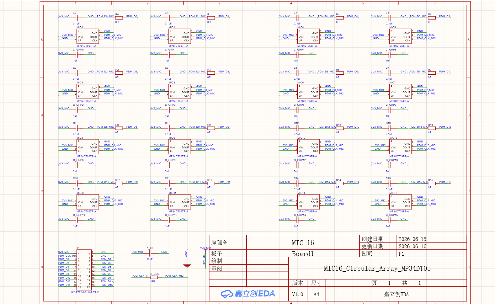

图6 16路数字麦克风阵列原理图

图6（续） 单路麦克风与排针、时钟接口局部放大

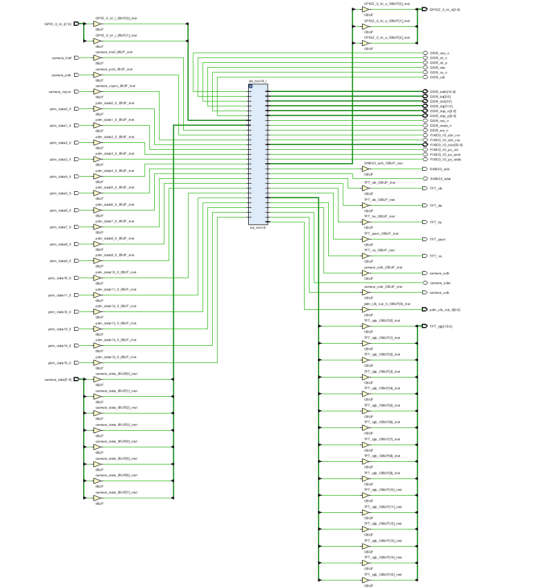

图7 Vivado顶层原理图，含此前视频接口

图中给出顶层端口、IBUF/OBUF与BD实例的连接关系。该图取自音视频集成阶段，其中camera、TFT和SiI9022为视频接口；本作品通过bd_mic16_dataflow_wrapper选择纯音频顶层，USB视频由PC采集。纯音频硬件的资源与时序结果列于第三部分。

### 2.3 FPGA逻辑设计

FPGA承担16路同步采集、数字抽取、FFT及空间扫描。采集通路持续运行，计算核按任务调用；两者通过DDR交接数据。设计首先控制重复运算与存储的开销，再根据存储端口和数据依赖确定流水方式。PS负责参数准备、PHAT与方向融合，PC负责视频和显示。图3给出BD连接，以下展开各自编模块的内部结构。

#### 2.3.1 时钟分配与复位控制

系统设置两个主要时钟域。FCLK0经Clocking Wizard提供100 MHz，驱动PDM接收、AXIS封包、DMA与HP0接口；FCLK1提供125 MHz，驱动共享FP64计算核、空间扫描核及其控制和HP接口。音频采样率由100 MHz域中的计数器决定，计算核的事务耗时则由125 MHz域中的流水和访存共同决定。

两个Processor System Reset分别对各自时钟域释放复位。FCLK_RESET0_N与时钟锁定信号接入复位模块，避免时钟尚未稳定时启动数据流。AXIS FIFO还设置局部复位门控，重新开始采集时先清除旧包，再启动采样和DMA。模块内部主要使用同步复位，使寄存器和存储控制更便于布局。

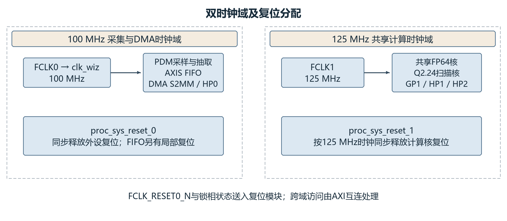

图8 采集与计算时钟域的划分及复位关系

PDM时钟由逻辑输出到阵列，返回DATA先经两级触发器同步到100 MHz域，再由采样使能取数。因此，PDM_CLK不作为片内新增时钟。时序约束仅切断外部DATA至第一级同步触发器的路径；第一级至第二级仍保留正常时序检查，两级均标记ASYNC_REG。AXI互连负责相应的跨域访问[9]。

#### 2.3.2 十六路PDM分时抽取

pdm_clk_gen按分频参数20每20拍翻转一次输出，得到2.5 MHz共享PDM时钟。采样使能设在下降沿之后，给麦克风输出与连接线留出建立时间。每64个PDM采样点得到一个PCM点，对应采样率为39062.5 Hz；16路共用采样脉冲和抽取计数，通道之间不因控制器轮转而错开采样时刻。

pdm_decimator_shared在采样脉冲到达时整组锁存16位数据，然后令channel从0递增到15，每拍处理一路。各路的积分、梳状差分、直流估计和后级滤波状态分别存放在分布式RAM中。通道编号与valid一起沿流水推进，状态写回原通道地址。这样可以共用加法、移位和饱和通路，同时保持16路历史状态独立。

100 MHz下相邻PDM采样组间隔40拍，16路依次进入运算通路，处理安排在下一组到来前完成。若新采样使能到达时上一组仍未分发结束，模块锁存schedule_error并增加饱和计数；该状态与封包溢出一起送给PS，便于识别采样节拍错误。

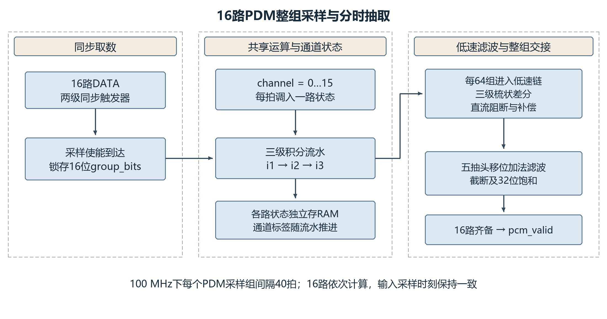

图9 整组同步采样与通道状态独立的共享抽取结构

滤波链由三级CIC积分、64倍抽取和三级梳状差分组成[11]，随后执行直流阻断、CIC通带补偿及五抽头平滑滤波。CIC累加保持32位，补偿中间量扩展4位；五抽头系数为1、4、6、4、1，使用移位加法并除以16，不为该滤波器单独使用通用乘法器。输出按原顺序截断、饱和为32位。复位只清有效标志，首次访问各路状态时按零处理，避免逐字清RAM。最后一路写入后才给出整组pcm_valid。

#### 2.3.3 音频封包与DMA写入

pdm_axis_pack_nch把同一采样时刻的16路32位PCM锁存为512位数据组，先送入8组深度的缓冲，再按通道0至15串行输出。样本优先的交织顺序与PS解包一致：先输出样本0的16个通道，再输出样本1。BD将SAMPLES_PER_PACKET设为2048，一个子帧共有32768个32位字，即131072字节。

AXI4-Stream仅在TVALID与TREADY同时为1时推进发送通道。下游暂停接收时，TDATA、TVALID和TLAST保持，避免暂停期间漏送或重复推进。TKEEP固定为0xF；TLAST只在第2048组的通道15有效，DMA据此确认整帧边界。8组缓冲吸收短时停顿，满时禁止覆盖并记录溢出。

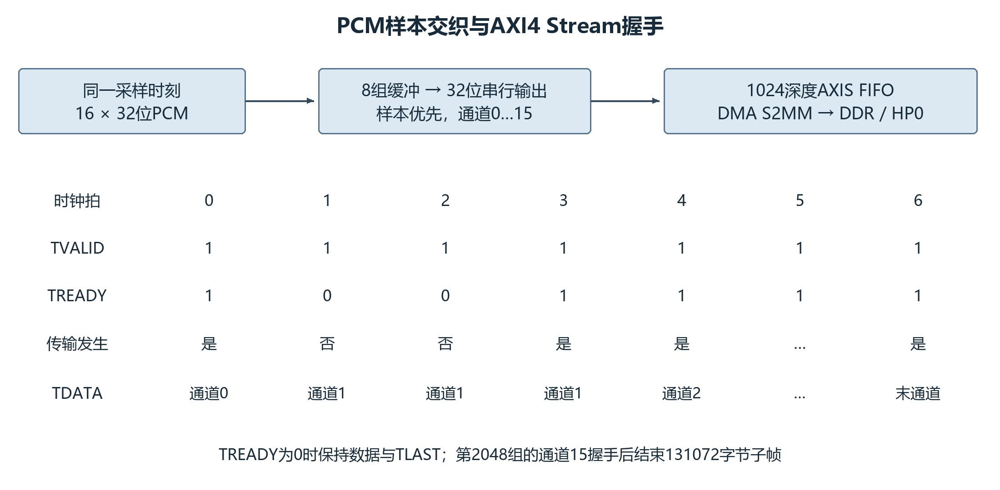

图10 PCM交织顺序及AXI4 Stream背压期间的保持行为

后接AXIS Data FIFO深度为1024，用于进一步隔离采样与DDR写入的瞬时等待。AXI DMA关闭MM2S和SG描述符模式，仅使用32位简单S2MM模式，将完整子帧写入PS给定的DDR地址。该配置直接服务采集，不把FFT输入输出绕经采集DMA；计算核使用各自的AXI主口访存[10]。

采集平均负载为16×39062.5×4＝2500000字节/秒，每52.4288 ms形成一个子帧。PL内的组缓冲和AXIS FIFO用于短时背压，DDR中的20帧PCM环用于持续保存样本，四帧独立快照用于定位。三个层次各有用途，定位期间不会长期占用DMA接收槽。

#### 2.3.4 共享FP64 FFT运算通路

公共频谱对每通道2048点实信号加窗并补零为4096点实变换，利用奇偶实样本压缩为2048点复数FFT。PS准备输入与旋转因子，PL执行FP64 FFT，PS再恢复实频谱和生成PHAT观测。保留双精度是为了维持公共频谱及后续峰值判断的数值关系，避免将精度变化混入架构调整。

共享核在AXI4-Lite寄存器中接收arena地址、描述符偏移和任务数，通过AXI主口取得任务。FFT模式先检查长度、数据范围及非有限数，再装载旋转因子，按位倒序把复数实部和虚部分别写入工作RAM。蝶形采用基2结构[14]：读取A与B，将B乘旋转因子后，计算A＋WB和A－WB，并写回原位置。

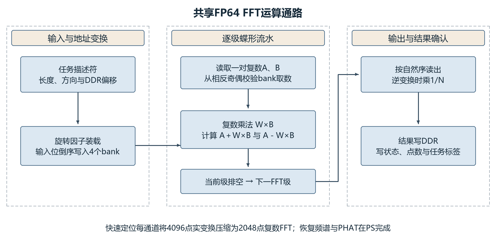

图11 描述符驱动的FP64 FFT处理与结果回写

蝶形内层设置II＝1的流水目标，每完成一级均先排空流水，再进入下一级，防止不同级读写尚未完成的数据。浮点加减按原先的表达式次序计算，HLS关闭表达式重平衡；减法通过符号翻转与加法组织，使相关模式能够复用FP64加法器。逆变换在输出时乘以1/N，结果以自然序写回DDR。

任务结束后，核先写返回状态和有效输出点数，再写任务标签。PS通过标签与完成状态确认该次结果，随后才释放工作区。当前快速定位调用该核的FFT模式；统计、物理投影与FIR模式保留在同一引擎中，按任务互斥运行，并不在快速定位中同时执行。

#### 2.3.5 片内存储映射与资源复用

FFT与投影若分别配置大容量工作RAM，会直接增加BRAM需求。共享核将工作数据统一为shared[4][2048]：4个bank，每项64位，每bank 16 KiB，共64 KiB。HLS把第一维完全分区，并将各bank绑定为真正双端口BRAM。旋转因子wr和wi各有2048个FP64存储项，另行配置双端口存储，不计入上述64 KiB。

FFT用索引二进制各位的异或值选择实部bank 0或1，虚部使用相应的bank 2或3，行地址为索引右移1位。基2蝶形的一对索引只相差一个二进制位，异或校验值必然相反，因此两点落在不同bank。每个bank承担自身的数据读写，避免把同一存储端口假设成能够同时完成全部蝶形访问。

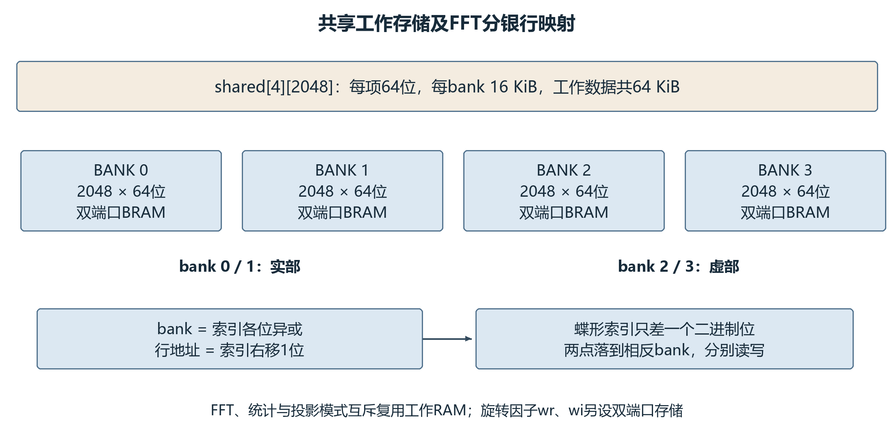

图12 四个双端口bank的复用范围及FFT地址映射

模式切换时复用同一工作RAM：FFT保存复数实虚部，统计与投影保存观测和系数小块，FIR保存输入及输出上下文。一次任务持有整个工作区，执行结束后才交给下一任务。由硬件描述符和PS的占用状态共同控制切换，避免两个调用者同时写同一bank。

HLS对FP64乘法器设置4个实例上限，对FP64加法器设置6个实例上限，并限制低频地址及范围检查函数的复制。存储分区用于满足必要访问端口，实例上限用于控制运算器复制，两者共同确定硬件规模[12]。这种共享节省重复实例，同时要求任务有序使用引擎，系统调度据此安排提交与回收。

#### 2.3.6 多频带定点空间扫描

空间扫描核接收807个频点、32个通道对的PHAT观测，对325个方向计算24频带响应。PHAT由PS生成，扫描的相位旋转、通道对累加及分频带归一化在PL完成。每个复数观测打包为一个64位字，实部和虚部各采用26位Q2.24；累加器为48位、16位整数，归一化系数采用40位、2位整数，使用收敛舍入及饱和边界。

每个频点先将32对观测读入片内缓存，再供全部方向重复使用。方向相关的初始相位和相邻频点旋转增量也装入片内；计算下一频点时用复数乘法递推相位，避免在方向循环中反复计算三角函数。前23个频带各含34个频点，末频带含25个频点，输出分别按通道对数与频点数归一化。

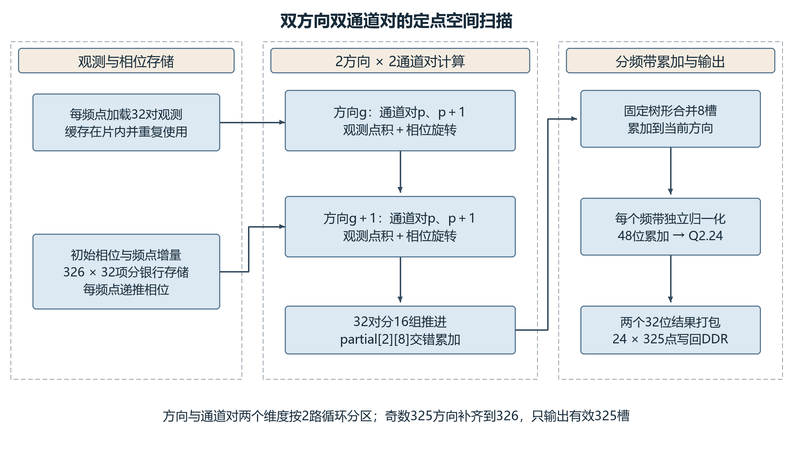

图13 观测缓存复用与双方向双通道对扫描结构

扫描采用2个方向与2个通道对的并行组合。325个方向补齐为326个内部槽，每次推进相邻两个方向；32个通道对分16组送入运算器。相位与旋转表在方向、通道对两个维度均按2路循环分区，使所需数据分别从独立存储bank取得。补齐槽只用于整齐组织循环，输出仍保留325个有效方向。

每个方向配置8个交错部分和，按通道对组号轮转更新；完成16组后用固定树形顺序合并。这样拉开同一累加器的访问间隔，减轻反馈依赖对流水的约束。每频带完成后将结果转回Q2.24，两个32位结果合为一个64位字写DDR，减少输出事务数量。

#### 2.3.7 AXI访问与任务控制

控制与数据搬运采用不同通路。PS经GP0访问DMA与GPIO，经GP1访问HLS核的AXI4-Lite寄存器，配置地址、启动位和状态。大块数据由PL的AXI主接口直接读写DDR：采集DMA使用HP0，扫描核使用HP1，共享FP64核使用HP2。USB摄像头直接接PC后，板端视频模块和HP3通路不再参与演示。

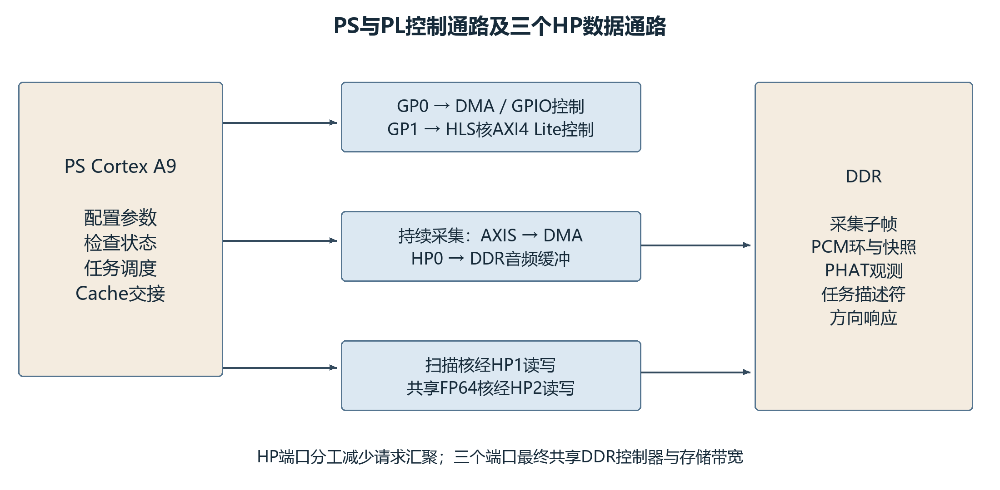

图14 AXI4 Lite控制与HP0 HP1 HP2数据访问分工

HP端口分工使持续音频写入与计算访问不必全部汇聚到同一PL主接口，但这些端口最终仍共享PS中的DDR控制器和带宽。设计通过片内观测缓存、旋转因子缓存及描述符批次减少重复DDR访问，而不是只增加主接口数量。PS准备缓冲后执行Cache清理，读取设备输出前执行失效，并以屏障约束交接顺序。

共享引擎一次最多接收8个任务描述符。PL在计算前核对协议版本、任务标签、长度和地址范围；不符合要求时返回错误，防止越界数据进入计算。结果与标签写回后，PS依据返回状态收取数据。扫描核采用独立地址区和控制寄存器，采集、扫描与共享FFT的缓冲归属分别管理。

#### 2.3.8 资源约束与时序收敛

Zynq-7020提供53200个LUT、106400个寄存器、140块BRAM及220个DSP。设计优先把PDM多通道历史状态放入分布式RAM，将FFT与空间扫描的大数组放入BRAM；定点扫描使用DSP乘法，补偿滤波等常系数运算使用移位加法。各模块的并行度由端口数、累加依赖与布局容量共同限制。

时序收敛中，把共享核的低频范围检查固定分成两拍，将FFT字地址生成拆为两级，避免地址移位、相加和AXI请求控制连成过长组合路径。位宽也按实际边界限定：FFT长度保留13位、模式保留3位，既能表示合法最大值和循环终止值，也减少宽控制网络。运算核心按原顺序流水，不用宽泛的多周期约束隐藏数据依赖。

采样与计算域分别按10 ns和8 ns预算检查。时序例外限制在明确的异步输入边界，片内同步器第二级及计算通路保留检查。完成布局布线后，建立裕量为0.063 ns，保持裕量为0.036 ns，DRC错误数为0；硬件资源占用见下表。

| 资源 | 已用／总量 | 使用率 |
| --- | --- | --- |
| LUT | 33140／53200 | 62.29% |
| 寄存器 | 40252／106400 | 37.83% |
| BRAM | 136／140 | 97.14% |
| DSP | 179／220 | 81.36% |

硬件整理还将图像采集与显示转移到PC，移除板端camera和video_hp3。对应集成阶段的资源对比如下；随后加入共享V6计算核形成上述当前资源配置。该对比记录视频通路退出时的硬件变化。

| 资源 | 音视频集成结构 | 移除板端视频后 |
| --- | --- | --- |
| LUT | 37714 | 32237，减少5477 |
| 寄存器 | 45182 | 38654，减少6528 |
| BRAM | 123 | 120.5，减少2.5 |
| DSP | 149 | 149 |

#### 2.3.9 模块验证与实现核查

硬件验证从数据顺序、数值结果和时序边界展开。抽取模块与原16路实现保持同一算术顺序，对照各通道输出及标签；封包模块检查暂停接收时的数据保持、通道顺序、TLAST和溢出行为。FFT核以固定输入逐位比较，扫描核按同一Q2.24规则核对输出，避免仅凭最终方向相近判断内部实现正确。

| 核查对象 | 检查内容 | 结果依据 |
| --- | --- | --- |
| 共享抽取与AXIS | 通道状态、复位、暂停与整帧边界 | RTL及封包／采集验证记录 |
| 共享FFT | 位倒序、bank地址与级间读写依赖 | 固定输入黄金值逐位比较 |
| 空间扫描 | 807频点、32对、24带与325槽 | 三组Q2.24数字输入对照 |
| 系统接口 | 设备状态、DDR归属及停止排空 | 两轮真实采集启停与RAW接收记录 |
| 物理实现 | 资源、建立／保持时序及DRC | Vivado综合与布局布线报告 |

固定输入实板对照每轮完成64次FFT和四帧扫描，记录278.817 ms与278.915 ms，输出与黄金值逐位一致。连续运行另以DMA归还、16路PCM接收和Qt更新分别计时，结果列于第三部分。由此可把计算核行为、采集接口和显示更新对应到各自的验证记录。

### 2.4 软件系统介绍

#### 2.4.1 软件整体结构与函数层次

板端采用Cortex-A9裸机常驻程序，入口为audio_dataflow_main.c中的main()。初始化网口与计算平台后，主循环轮询网络、控制和平台任务；控制回调与DMA中断负责事件交接，定位计算由分阶段任务推进。PC采用Qt事件循环，网络工作线程负责接收，界面线程绘制最新结果与USB图像。数据流模型[13]为采集与处理速率、取数规模和缓冲容量的设计提供依据，实际选窗按运行状态动态调度。

软件按常驻调度、采集缓冲、频谱扫描、方向判定、通信与显示分层。构建配置M16_FAST_DISPLAY_ONLY=1和M16_LOCALIZATION_ONLY=1，板端运行主导方向定位，PC负责声像显示。各层通过状态、元数据和任务接口交接，具体调用关系如下。

上位机界面按操作分为设备控制、定位显示、声源结果和音频监视四个区域。板卡加载固件后点击“连接”完成通信与能力查询，再点击“开始定位”启动持续处理；“停止定位”请求板端停止并排空缓冲。窗口右上角及提示栏显示连接、就绪和运行状态，摄像头可以独立打开。

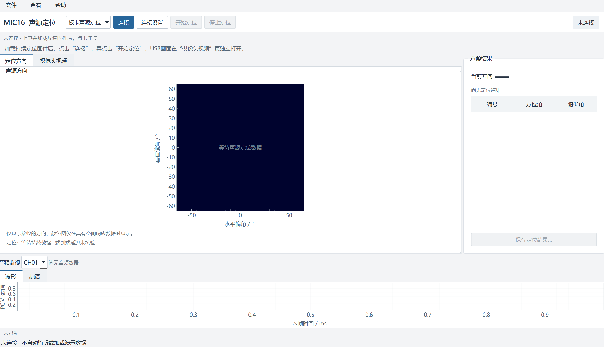

图15 上位机定位方向页面与控制区域（待机界面）

“定位方向”页以深蓝底小圆点显示当前主导方向，坐标轴为水平与垂直偏角；右侧结果表给出同一方向在PCB平面基准下的方位角和俯仰角，并提供结果保存。下方可选择16路PCM中的某一通道，切换波形或频谱观察输入变化。方向读数与绘图均随新结果更新。

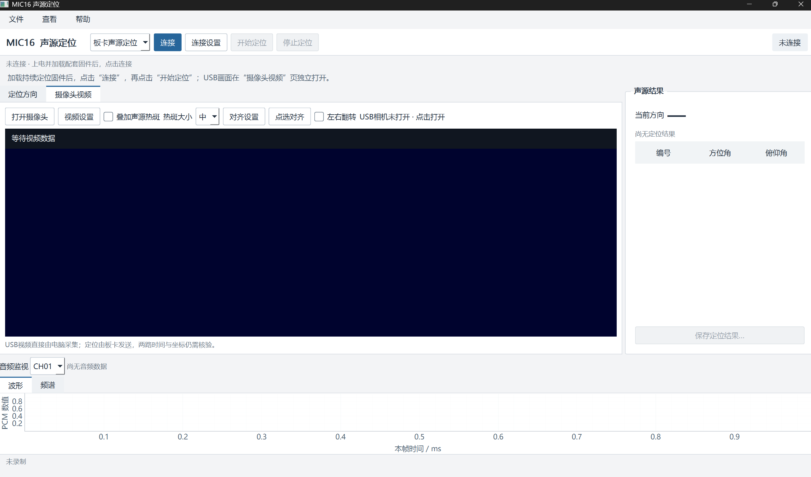

图16 USB摄像头与声源叠加页面（待机界面）

“摄像头视频”页直接读取电脑USB摄像头，板卡仍负责声学定位。操作栏提供视频设置、声源热斑开关、大小选择、对齐设置、点选对齐及左右翻转。声学方向经安装坐标与图像投影后，形成局部红黄蓝渐变标记，与USB图像合成；叠加范围可调，便于观察声源附近的场景。

build/ps_recipe.json记录各编译单元采用的源码、宏与编译命令，build/inputs保存相应版本快照。report/function_index.md按实际构建输入列出关键函数的相对路径及行号，便于从框图逐层查找实现。

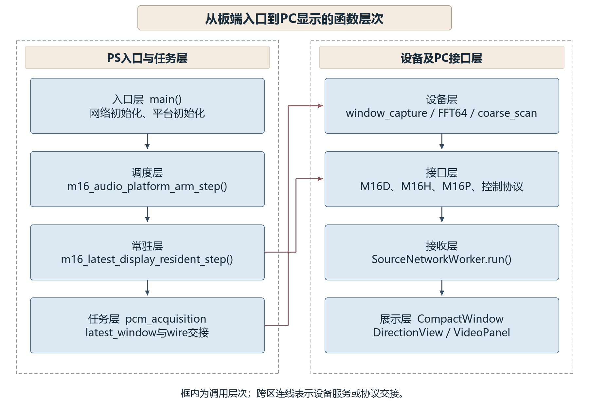

图17 从板端入口到PC显示的函数层次

#### 2.4.2 主循环与常驻调度

main()先核对参考数据和浮点环境，配置2048点DMA子帧及20帧预热，然后调用m16_network_init_resident()与m16_audio_platform_arm_init()。待平台就绪后，HELLO查询得到能力和状态，START才建立递增epoch并启动采集；加载程序本身不发START。

主循环每批最多执行32次平台step，并在有界节点之间检查计时器，以约500 μs为网络和控制服务检查间隔。常驻step依次推进采集、控制、共享计算后端、RAW复制、单包发送和选窗分析。硬件事务依次提交和轮询，结束后释放设备；异常状态保留故障码并执行排空，确保缓冲和设备资源得到归还。

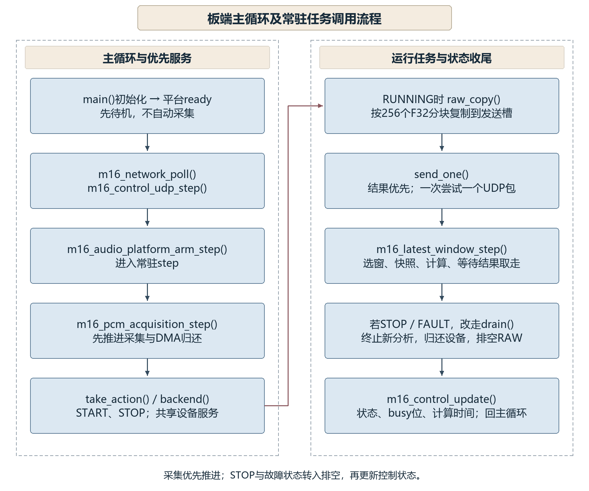

图18 板端主循环及常驻任务调用流程

| 函数或状态 | 关键输入 | 输出与交接 |
| --- | --- | --- |
| main() | 采集cfg、网络配置、计时器 | platform.ready；持续调用平台step |
| resident_step() | control、producer、analysis、tick | 运行状态、busy位、latest_sequence |
| backend() | 已提交FFT等事务 | 完成或错误；释放设备使用权 |

#### 2.4.3 DMA采集与PCM缓冲管理

采集层维护三组DMA缓冲，m16_window_capture_step()处理完成状态和数字幅值归一化。m16_pcm_acquisition_step()取得完整帧及缓冲编号后，逐次复制256个F32到20帧PCM环。写入前令目标槽ready=0；整帧完成后才置ready=1、推进next_frame，并调用release()归还DMA缓冲。定位模块由此不会把新旧数据混成一帧。

每帧PCM为2048×16个小端F32，共131072字节。20帧环约2.5 MiB；分析快照为4帧、512 KiB；RAW使用2个独立发送槽、256 KiB。它们位于DDR，不占用同等容量的片内BRAM。单帧复制、分析复制和网络发送分别推进，采集不等待一次定位算完。

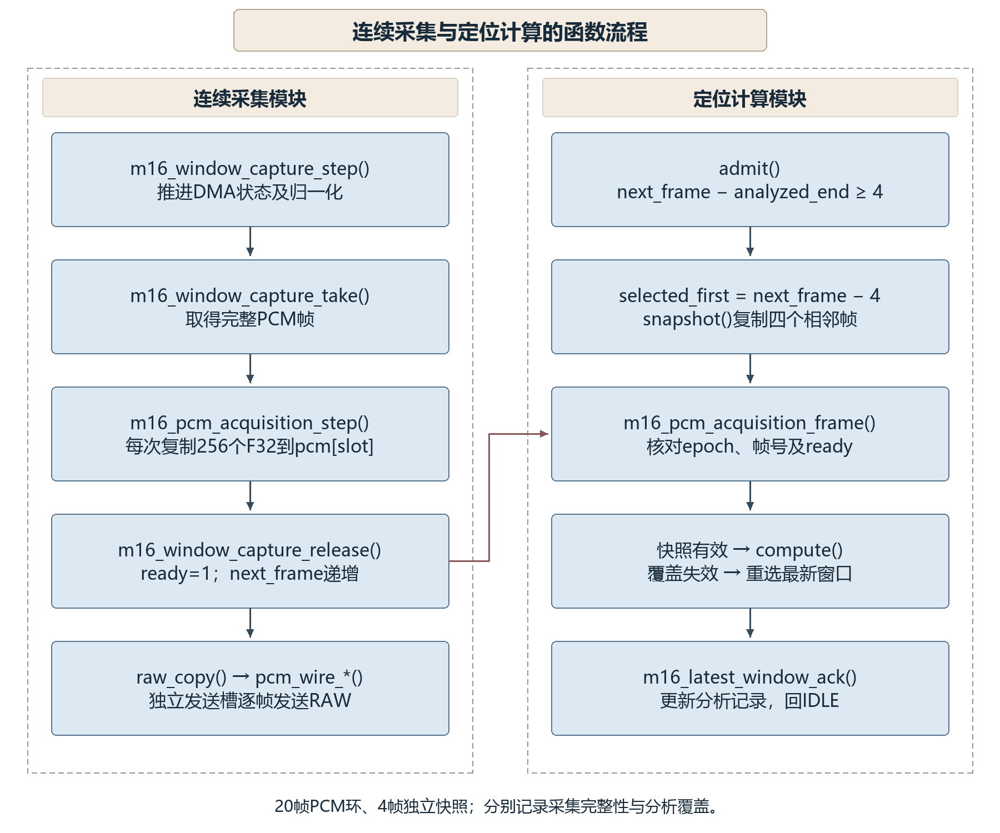

图19 连续采集与定位计算的函数流程

| 函数或状态 | 关键输入 | 输出与交接 |
| --- | --- | --- |
| capture_step()/take() | DMA完成槽、epoch | PCM帧、缓冲编号、first_sample |
| acquisition_step() | lease.pcm、copy_cursor | pcm[frame%20]、ready、next_frame |
| acquisition_frame() | epoch与绝对帧号 | 只读PCM和metadata；过期返回错误 |

#### 2.4.4 最新四帧快照与定位调度

m16_latest_window_step()依次推进IDLE、COPY、COMPUTE和OUTPUT。admit()要求已有至少四个新帧，令selected_first=producer.next_frame−4。snapshot()分块复制这四个相邻帧，每次重新核对epoch、frame和metadata；若环槽已被覆盖，就放弃未完成快照并重选，不把已覆盖数据交给前端。

快照完成后，compute()为四帧逐一提交公共频谱和空间扫描，同时推进主导方向任务。front_busy、front_ready和coarse_busy限制单工作区复用，只有扫描完成并置ready后，方向任务才能复制响应。结果发送完成后ack()释放输出，记录analyzed_end、skipped_frames及已分析四帧区间，再回IDLE。

最新窗口策略将连续采集与选择性定位分析分开：PCM按原采样节拍写入并传输，分析任务从中选取最新四帧，每组覆盖209.7152 ms音频。系统分别记录分析覆盖区间、UDP接收完整性和DMA状态，以便追踪每条定位结果的样本来源，同时控制计算积压。

| 函数或状态 | 关键输入 | 输出与交接 |
| --- | --- | --- |
| admit()/snapshot() | next_frame、analyzed_end、metadata | selected_first、独立pcm[4] |
| compute() | 四帧快照、front/coarse状态 | 响应ready与m16_fast_doa_result |
| ack()/record() | epoch、sequence | 输出释放、覆盖与跳过计数 |

#### 2.4.5 公共频谱与PHAT观测

m16_public_spectrum_begin()接收一帧2048×16 PCM，step()按通道完成范围检查、去均值与Hann加窗。4096点实数变换将偶奇样本压缩为2048点复数FFT，再恢复实数频谱。补零用于细化频域采样，FFT分解原理见文献[14]；实现保留约定的字长与运算顺序。

FFT由provider.request()/poll()提交给PL共享FP64后端，PS完成加窗、频谱恢复与PHAT观测生成。频率索引32～838对应807个频点，约305～7992 Hz；32个通道对包含16组相邻、8组跨两路和8组跨四路组合。每个频点计算归一化互功率谱，低幅值项置零；24频带的平均功率转为相对电平，供后级质量筛选。

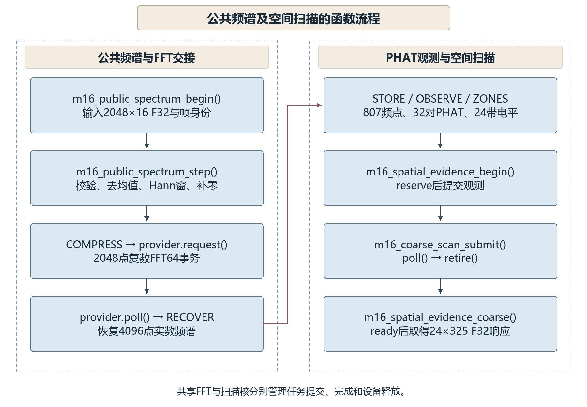

图20 公共频谱及空间扫描的函数流程

| 函数或状态 | 关键输入 | 输出与交接 |
| --- | --- | --- |
| begin()/step() | pcm、epoch、frame | spectrum：807×16个复数FP64 |
| OBSERVE | 通道对复频谱 | phat：807×32×2个F32 |
| ZONES | mean_channel_power | zone_level_db[24]；非SPL |

#### 2.4.6 共享计算后端与空间扫描

m16_shared_compute_graph_init()将公共频谱的FFT provider绑定到m16_fft64_graph，service()轮询已提交任务，由shared_projection中的FP64 FFT算子执行变换。提交前清理Cache，读取结果前使Cache失效，交接顺序通过屏障约束。公共FFT64的执行位置由该绑定关系确定，BD中的d4f_tf_front_q24作为兼容模块保留。

扫描由m16_spatial_evidence_reserve()/begin()管理缓存槽。step()调用m16_coarse_scan_submit()把PHAT观测送给d4f_tf_zone_q2_24，完成poll()和retire()后，才发布24×325个F32响应。响应按epoch和绝对帧号查询，调用者不能把返回指针长期占用。

软件向同一空间扫描核装入前半球方向表：25个方位槽×13个板面俯仰槽，归并接缝与法线重复后形成289条独立射线。扫描沿统一时延约定完成相位旋转和累加，方位步长15°、板面俯仰步长7.5°；显示层对离散响应进行插值着色。

| 函数或状态 | 关键输入 | 输出与交接 |
| --- | --- | --- |
| fft64_request()/service() | 实虚部、旋转表、长度、client | FFT结果、完成状态、使用权 |
| coarse_scan_submit() | 807×32复观测、几何表 | 24×325响应及设备状态 |
| evidence_coarse() | epoch、frame，且slot.ready | 当前帧响应；身份不符则拒绝 |

#### 2.4.7 主导方向融合与质量判定

m16_fast_doa_begin()复制响应和24个带电平，不重新运行FFT或扫描。MAX找本带峰值，SECOND找15°邻域外的最大值；仅保留电平距本帧最高带不超过20 dB、峰值不低于0.15且对比度不低于0.02的频带。权重取峰值与对比度的乘积，ADD累加各方向响应，NORMALIZE得到单帧归一化图。

四帧齐备后，FUSE对有效帧响应求均值，PEAK确定主导峰，CONTRAST计算融合对比度。publish()要求融合峰不低于0.15、对比度不低于0.02，且至少两帧的峰位于融合峰15°邻域内。通过则valid=1；否则仍发送无效原因，使PC清除标记。所有方向循环每步最多64项，质量归约保持原FP64顺序。

输出包括主导方向、325点响应、支持率、对比度和采样区间，支持率与对比度用于描述方向质量。板端发送原生射线角，Qt根据独立保存的安装姿态换算为PCB平面基准的方位角和俯仰角，确保方向读数与显示使用统一坐标。

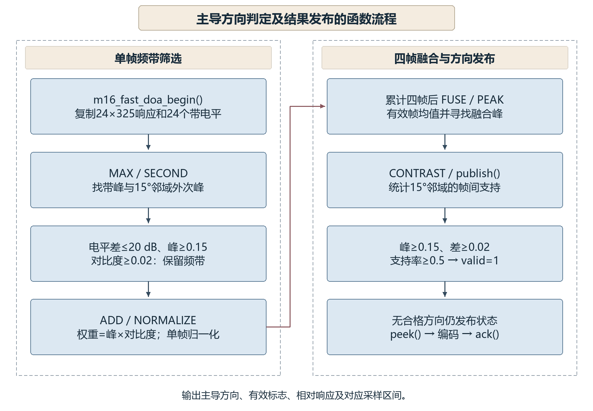

图21 主导方向判定及结果发布的函数流程

| 函数或状态 | 关键输入 | 输出与交接 |
| --- | --- | --- |
| begin() | maps[24][325]、levels[24] | 私有输入副本、MAX阶段 |
| step()/publish() | history[4][325]、融合峰与邻域 | valid、reason、grid、response[325] |
| peek()/ack() | epoch、sequence | 只读结果及发送后释放 |

#### 2.4.8 UDP编码与控制接口

send_one()优先发送待发布定位：m16_latest_display_encode()先生成M16D方向包，再把325点响应分为两个M16H包。三包携带相同boot、epoch、sequence及起止样本，响应有效但质量不通过的结果也带valid=0。发送完成才调用m16_latest_window_ack()；网络背压保留当前包，超时报告故障。

无待发结果时，RAW发送任务处理两槽队列。m16_pcm_wire_begin()/packet()/ack()把一帧16路F32分成128个1088字节M16P包；CRC、片号与采样轴供PC重组。控制使用5004端口，HELLO、START和STOP与状态回复分开；方向、响应和RAW分别使用5001、5003和5005端口。

| 函数或状态 | 关键输入 | 输出与交接 |
| --- | --- | --- |
| latest_display_encode() | result、boot、tick_hz、part | 小端M16D或M16H；含CRC |
| pcm_wire_*() | PCM、epoch、first_sample | M16P片段；ack后推进片号 |
| control_udp_step() | 命令、请求身份、当前时间 | 控制确认和状态；不直接执行算法 |

#### 2.4.9 Qt接收与当前方向显示

CompactWindow.connect_device()打开接收线程并发起能力查询。SourceNetworkWorker.run()通过select监听方向和RAW，检查来源IP、长度、CRC和epoch；decode_direction()还核对协议版本和方向槽。DisplayResultStore.accept_current()只接收同一运行身份中递增的序号，旧epoch、重复或迟到包不能刷新当前画面。

_publish()在一个受锁保护的槽中保留最新待绘方向，只有该槽首次变为待取时发出fast_frame_ready，防止GUI事件越积越多。界面线程经_fast_packet_arrived()、_refresh_source_udp()和_apply_fast_direction()更新角度表及DirectionView。RAW独立重组为完整16通道帧后，通过_redraw_source_audio()更新所选通道波形；RAW错误与定位接收状态分别显示。

_apply_fast_map()核对方向与空间响应的same_observation()身份，并要求两者本机接收后经过时间小于1 s。方向包到达即可更新读数，完整响应配对后再用于视频叠加；无效或过期结果清除标记。定位页采用深蓝底小圆点，空间响应保存在数据层，供视频着色与运行诊断使用。

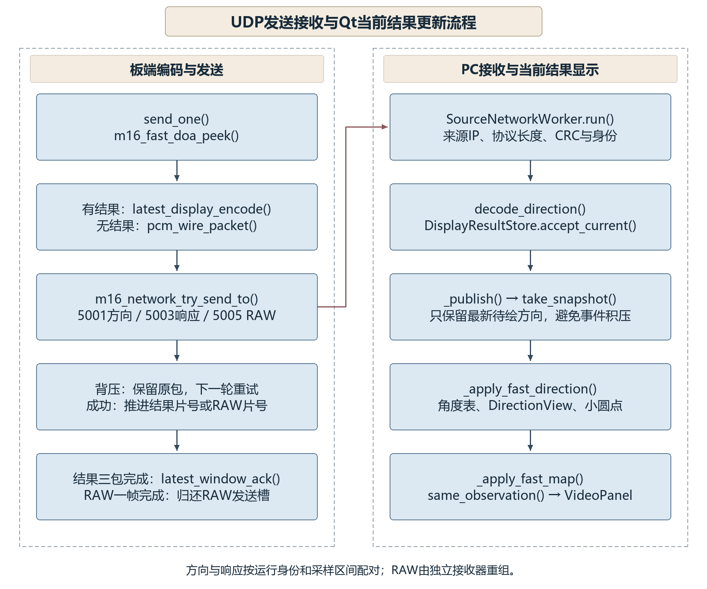

图22 UDP发送接收与Qt当前结果更新流程

| 函数或状态 | 关键输入 | 输出与交接 |
| --- | --- | --- |
| accept_current() | FastDisplayFrame及绑定boot/epoch | 当前结果、序号缺口与未分析区间 |
| _apply_fast_direction() | 递增sequence、valid、射线角 | 方向表、小圆点及运行记录 |
| _apply_fast_map() | 同身份方向与完整响应 | VideoPanel输入，或继续等待 |

#### 2.4.10 USB视频与声像叠加

VideoPanel.start_usb_video()按设备标识启动UsbCameraPreview。Qt的QCamera、QMediaCaptureSession和QVideoSink接收USB帧，_accept_frame()核对本次generation，take_latest()交出最新帧。VideoPanel._poll()更新图像并保持宽高比。USB视频约30 fps到达，定位按自身结果周期更新，两类数据在显示层合并。

声像层按安装旋转将原生方向变换到相机坐标，project_direction()再根据中心方向、水平及垂直视场和偏移，透视投影到归一化图像位置。点选与多点对齐用于建立固定安装下的方向至像素映射；声学角度读数采用独立坐标配置，图像对齐参数只作用于叠加显示。

_update_physical_overlay()检查方向与响应配对、有效性、1 s结果有效期及相机配置，再由response_rgba()生成局部渐变透明层。同一结果在相邻视频帧间复用，响应或参数变化时更新投影。paintEvent()对底图与叠加应用相同镜像；视频或方向失效时隐藏标记。标记以真实空间响应为输入，半径和色彩衰减控制显示范围，响应采用相对量表示。

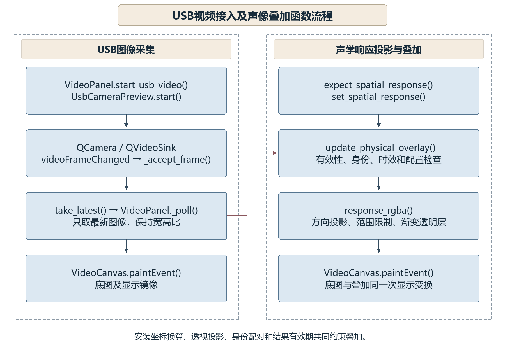

图23 USB视频接入及声像叠加函数流程

| 函数或状态 | 关键输入 | 输出与交接 |
| --- | --- | --- |
| start()/_accept_frame() | USB设备、格式、generation | 最新QVideoFrame和本机到达时间 |
| project_direction() | 射线角、安装/视场/偏移 | 归一化位置u、v；视场外返回None |
| set_spatial_response() | 方向与响应同一key | 配对响应生成透明层，与视频合成 |

#### 2.4.11 停止排空与故障处理

STOP把常驻状态转为DRAINING，先停止启动新的定位任务，再请求采集结束。drain()继续复制和发送已完成的RAW，并轮询取消中的共享事务；PCM发送、快照及设备使用权全部可释放后，才回IDLE。新的START必须使用递增epoch并重置计数，旧包不能关联到新一轮。

程序分别管理正常停止与故障状态。数据过期、采样轴不连续或发送超时转入FAULT，确认DMA和IP结束后释放存储。板端保持常驻，START与STOP控制采集和定位，PC连接与断开管理接收界面。日常持续包由使用者手动停止，9 s与60 s包用于自动限时诊断。

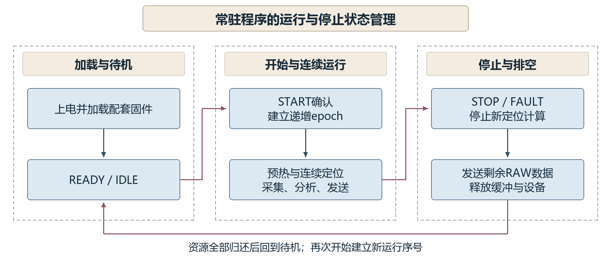

图24 运行与停止排空状态流程

#### 2.4.12 工具版本与复现流程

设计使用Vivado 2020.2、Vitis 2020.2和Vitis HLS 2020.2。原AC880例程、BSP及HLS IP均基于这套工具，因此保留同版环境，复用已通过检查的引脚与时序约束。指南允许说明后使用其他版本，工程重建脚本按2020.2编写[7]。

PC端上位机版本为0.5.0-compact-localization，当前运行环境为Python 3.13.5、Qt/PySide6 6.8.3、pyqtgraph 0.14.0和NumPy 2.5.3。代码包分别提供工具版本表和PC依赖清单。

工程包包含146个PS编译单元的输入与命令、PL源文件及导出脚本、Skill和设计报告。board/runtime.py --check核对配套文件，执行--load完成加载并打开Qt，连接后点击开始定位。build/rebuild_ps.py按构建记录重建PS，146个编译单元已完成源码编译和链接。PL构建使用2020.2工具、对应IP及工程约束。

| 工具 | 版本 | 使用范围 |
| --- | --- | --- |
| Vivado | 2020.2 Build 3064766 | BD与RTL/IP集成、综合、布局布线和时序分析 |
| Vitis | 2020.2 ARM GCC 9.2.0 | 裸机BSP、ARM固件编译及XSCT加载 |
| Vitis HLS | 2020.2 Build 3064766 | C/C++共享计算核生成，采用Vivado IP Flow |

复现时可先通过report/function_index.md查看主函数和分层接口，再依次进行配套文件检查、PS构建与板端加载。函数流程图分别表达任务顺序、消息传递和缓冲使用权；共享核由单事务占用，任务结束后交给下一任务。

## 第三部分  完成情况及性能参数

### 3.1 整体介绍

系统已完成16路阵列采集、PS/PL计算、UDP传输和Qt连续显示，支持停止排空与再次开始。演示界面显示当前主导方向、通道波形及USB视频声像叠加，软件操作集中于连接、开始和停止。

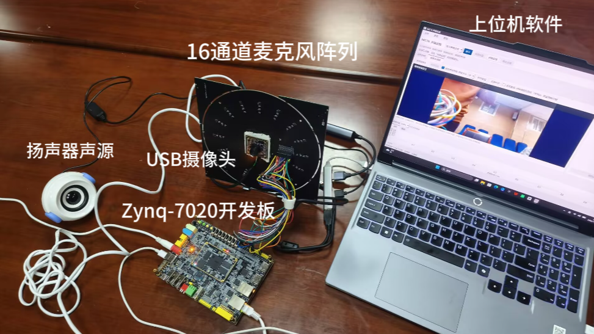

图25 作品总览

### 3.2 工程成果

#### 3.2.1 机械成果

实体原型由圆形阵列PCB、开发板、USB摄像头和连接组件组成。下图记录了室内测试平台：扬声器作为声源，阵列接入开发板，电脑显示定位及视频。测试时固定阵列与相机，避免转接线拉动改变朝向。

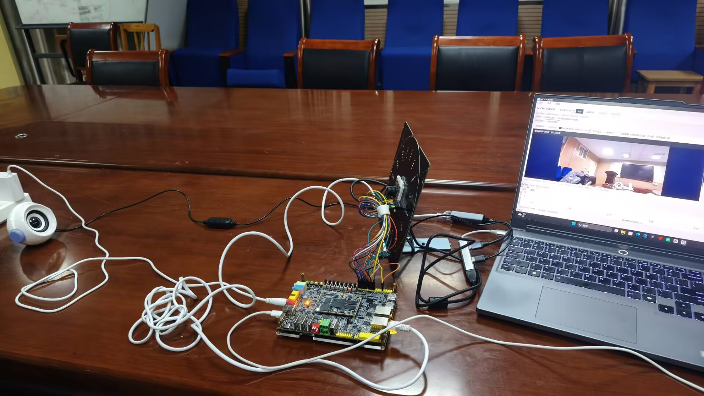

图26 测试平台搭建

#### 3.2.2 电路成果

16通道圆形阵列已接入开发板并运行采集。电路设计包含独立数据线、共享时钟、供电去耦与转接接口。生产设计的16路网络、80 mm阵列坐标、17个PDM端口及10400项冻结时延表完成一致性核对，时延表最大差为0。

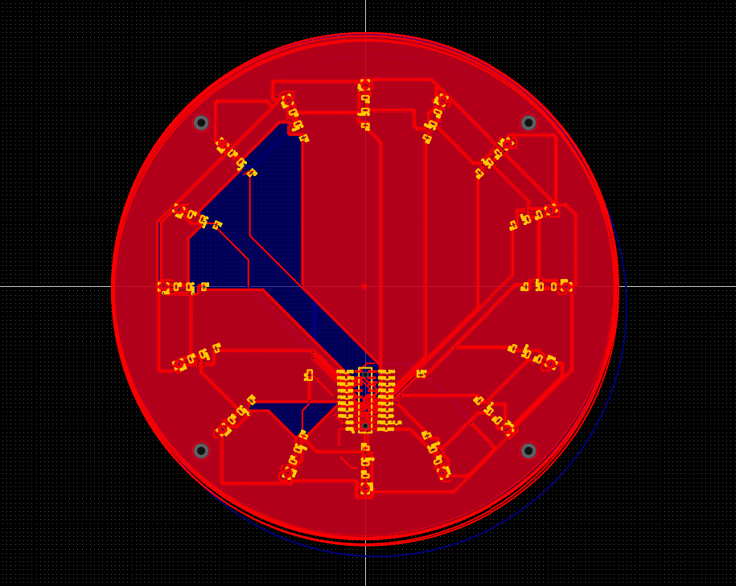

图27 16通道圆形阵列PCB布局

#### 3.2.3 软件成果

Qt持续接收声源方向、空间响应和16路PCM，同时独立采集USB视频。定位页用深蓝底小圆点表示主导方向，视频页在对应区域叠加可调大小的红黄蓝渐变标记。现场演示中，标记可随声源位置变化；软件支持开始、停止、重新连接以及定位结果保存。下图展示单声源定位、声像叠加与波形显示。

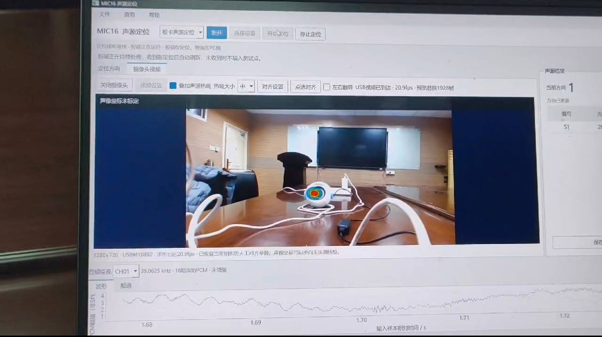

图28 单声源声像叠加与波形显示测试

下列测试图分别展示定位标记与相对空间响应。定位页采用方向小圆点，视频页采用局部渐变标记；标记大小可按观察需要调整。响应图的横纵轴为水平、垂直偏角，角度表采用PCB平面基准的方位与俯仰，色标表示相对响应。

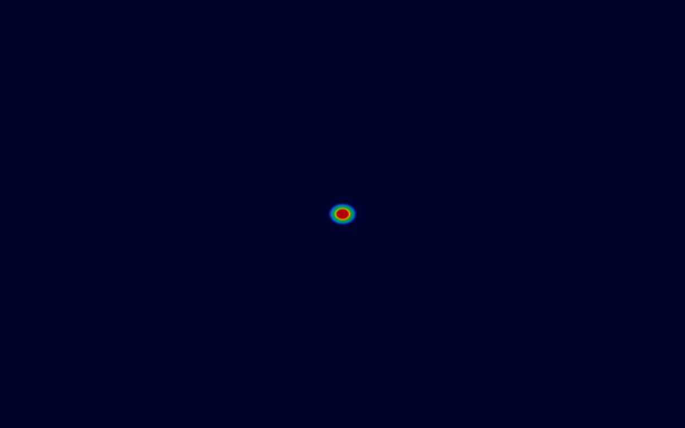

图29 测试时的定位标记显示

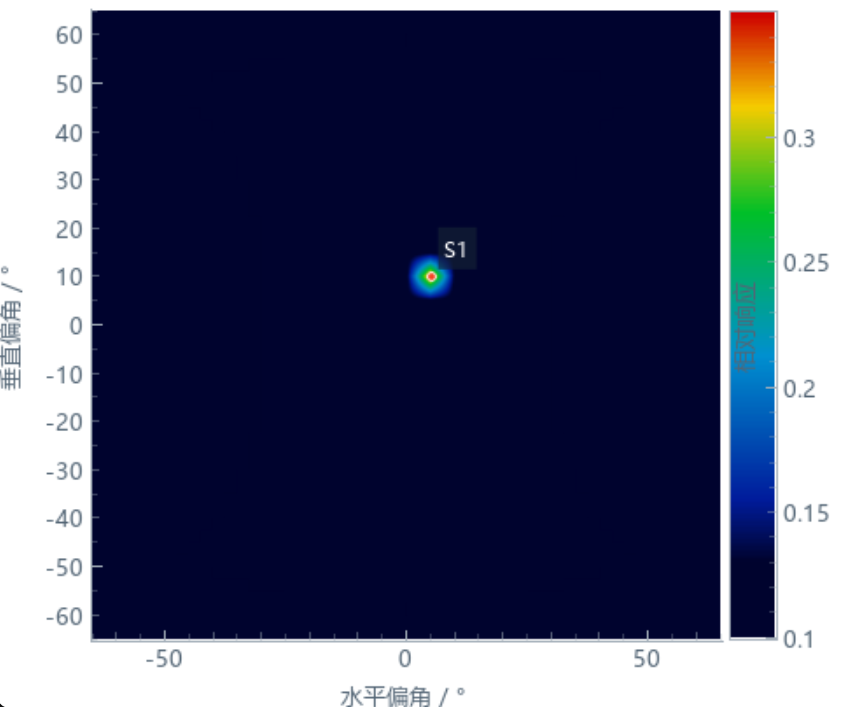

图30 测试时的相对响应与方向坐标显示

### 3.3 特性成果与测试条件

64窗新房间场景定位性能

定位性能测试得到综合F1为0.8722，总体精确率95.08%，命中源平均角误差2.56°；其中24个单源样本均完整检出。统计结果如下。

| 指标 | 测试结果 | 统计对象 |
| --- | --- | --- |
| 综合指标F1 | 0.8722 | 64窗新房间场景 |
| 命中源平均角误差 | 2.56° | 正确匹配的声源 |
| 单源完整检出 | 24/24 | 64窗中的24个单源样本 |
| 总体精确率 | 95.08% | TP/(TP＋FP)＝58/61 |

测试条件：C16分频带竞争评分模型＋15°去重，新会议室几何离线仿真64窗，复用开发声源素材；TP/FP/FN＝58/3/14。下文另列快速主导方向路径的实板运行结果。

连续调度、固定输入和启停测试分别检查显示更新、数值一致性与资源归还。连续调度基线采用有限扫描网格，约30.72 s内记录62次计算及Qt绘制，并核对16路PCM。计算、接收与绘制分别计时，条件见表。

| 测试项目 | 真实结果 | 计时与测试条件 |
| --- | --- | --- |
| 真实连续计算 | 均值470.889 ms；最大474.703 ms；62次 | 四帧快照完成至定位计算结束 |
| Qt实际刷新 | 均值470.339 ms；最大565.445 ms | 61个间隔，平均约2.12次/秒 |
| 首次方向显示 | 1789.910 ms | 含20帧预热、四帧采样与首组计算 |
| 首轮音频接收 | 566帧，72448包，完整接收 | 约30.72 s启停区间；逐帧与板端核对 |
| 独立数字计算 | 278.817 / 278.915 ms；逐位一致 | 固定数字输入的独立计算链 |
| 两轮真实启停 | 各152帧、19456包；各16次结果/响应 | 第9秒自动STOP，约9.197 / 9.204秒回待机 |

连续调度基线完整接收566帧、72448个RAW包，最后帧号565与板端一致，566个DMA缓冲均已归还。62条结果中48条满足质量条件，14条以无效状态通知界面，避免作为有效方向叠加。248帧进入已完成分析组，组间304帧和停止尾部14帧仍经RAW完整传输。后续两轮启停各采集152帧、分析64帧，RAW合计304帧、38912包完整接收，停止后采集缓冲全部归还。

前半球配置复用同一BIT，以325个扫描槽表示289条独立射线，并完成几何、三组Q2.24数值模型及81项上位机与协议检查。上述计时数据对应连续调度基线的有限扫描网格，硬件资源统计对应两种配置共用的实现。

硬件布局布线结果为LUT 33140/53200（62.29%）、寄存器40252/106400（37.83%）、BRAM 136/140（97.14%）、DSP 179/220（81.36%）。建立时间裕量0.063 ns，保持时间裕量0.036 ns，DRC错误为0。该统计包含复用硬件包与兼容模块，反映整套实现的资源占用。

### 3.4 优化过程与资源对照

历史逐子帧方案中，定位前端随采集帧逐帧推进，实测完成间隔91.8709 ms，高于52.4288 ms输入周期，首条定位结果出现前即耗尽采集槽。改进采用20帧PCM环承接连续输入，完成分片复制即归还DMA缓冲；定位仅持有最新连续四帧的独立快照，RAW发送另行推进。同平台测试实现566帧完整接收和62条连续结果输出，Qt平均更新间隔470.339 ms、最大565.445 ms。采集不再等待定位完成，界面按新的分析窗口持续更新。

资源复用方面，16路抽取共用运算结构并分别保存滤波状态，FFT与投影复用64 KiB工作存储，减少重复实例。上述调度改进沿用同一BIT，未增加PL资源，整机LUT、寄存器、BRAM及DSP数量如下表。质量与时效管理将14条未满足规则的结果标记无效，并按运行序号、采样区间和有效期拦截旧结果。分析按最新窗口选择，采集完整性与分析覆盖率分别记录。

| 比较项 | 逐子帧分析阶段 | 最新窗口阶段 |
| --- | --- | --- |
| 分析取数方式 | 每个子帧依次完成前端 | 20帧PCM环＋最新四帧独立快照 |
| 处理与显示节拍 | 前端91.8709 ms/帧，输入52.4288 ms/帧 | Qt均值470.339 ms、最大565.445 ms/次 |
| 采集与结果输出 | 首条定位前采集槽耗尽 | 566帧/72448包完整；输出62条结果 |
| LUT / FF | 33140 / 40252 | 33140 / 40252，同BIT |
| BRAM / DSP | 136 / 179 | 136 / 179，同BIT |
| 建立/保持裕量 | 0.063 / 0.036 ns | 0.063 / 0.036 ns，同BIT |

### 3.5 大模型协作与技能包

大模型协作用于任务划分、性能分析和验证步骤设计。工程依据源码检查、数值对照及实板记录筛选建议，并在report/llm_collaboration.md归纳设计建议、纠错过程与验证结果。

协作中形成的主要设计调整包括：按采集、计算和显示分别计时，明确软件与硬件的工作量；将阵列安装坐标与相机投影分开管理；按前半球方向重新组织扫描表。显示方式根据实际观察调整为定位页小圆点与视频页局部渐变叠加。

skill/收录可复用的检查流程、缓冲与Cache排错清单、结果时效和覆盖审计脚本，以及通过和失败样例。每项给出适用条件、操作步骤、验证记录与失效情况，便于迁移至其他DMA流处理工程。系统采用裸机程序与Qt完成运行及显示。

## 第四部分  总结

### 4.1 可扩展之处

后续可扩展精细多声源定位，将C16候选、130维特征与冻结模型用于独立的异构加速研究，比较共享算子、局部缓存及PS/PL交接开销；PC端可增加逐源增强。声像显示可引入平面标定法测量相机内参和畸变[15]，结合固定安装开展多点对齐。前半球扫描的角度误差、动态跟随[4]、声音到画面的延迟及长时间运行性能，可在统一平台上进一步量化评价。

### 4.2 心得体会

本作品的开发使我们认识到，连续系统的设计需要同时考虑计算工作量与数据占用时间。单次计算可以按步骤顺序执行，连续采集则要求每个缓冲都按时归还。若计算长期持有采集槽，即使局部运算有所加速，整体仍会积压。

因此，我们按数据生命周期划分任务：DMA帧复制完成即归还，PCM环承接连续样本，定位任务使用独立快照，RAW发送逐包推进。各模块只在明确的状态下交接数据，运行记录同时保留采样范围和分析覆盖情况。这样既便于定位问题，也使启停后的资源状态更清楚。

性能分析采用分段计时。连续调度基线约0.47秒的更新间隔与首次显示所需时间分别记录，固定数字输入用于核对数值与计算过程，真实采集用于检查网络和启停。将测量起止点落实到代码，比用单个总时间判断所有模块更有效。

大模型提供了设计思路和排查线索，工程决策最终落实到代码、仿真与实板记录。我们将可重复使用的检查方法整理为技能包，保留典型故障、排查顺序和判定条件，使其他工程能够参考同一套步骤处理缓冲交接、Cache一致性与持续显示问题。

## 第五部分  参考文献

[1] KNAPP C H, CARTER G C. The generalized correlation method for estimation of time delay[J]. IEEE Transactions on Acoustics Speech and Signal Processing, 1976, 24(4): 320-327. DOI:10.1109/TASSP.1976.1162830.

[2] DIBIASE J H, SILVERMAN H F, BRANDSTEIN M S. Robust localization in reverberant rooms[M]//BRANDSTEIN M, WARD D. Microphone Arrays: Signal Processing Techniques and Applications. Berlin, Heidelberg: Springer, 2001: 157-180. DOI:10.1007/978-3-662-04619-7_8.

[3] COBOS M, MARTI A, LOPEZ J J. A modified SRP-PHAT functional for robust real-time sound source localization with scalable spatial sampling[J]. IEEE Signal Processing Letters, 2011, 18(1): 71-74. DOI:10.1109/LSP.2010.2091502.

[4] GRONDIN F, MICHAUD F. Lightweight and optimized sound source localization and tracking methods for open and closed microphone array configurations[J]. Robotics and Autonomous Systems, 2019, 113: 63-80. DOI:10.1016/j.robot.2019.01.002.

[5] DA SILVA B, SEGERS L, BRAEKEN A, et al. Design Exploration and Performance Strategies towards Power-Efficient FPGA-Based Architectures for Sound Source Localization[J]. Journal of Sensors, 2019, 2019: 5761235. DOI:10.1155/2019/5761235.

[6] DA SILVA B, SEGERS L, BRAEKEN A, et al. Runtime reconfigurable beamforming architecture for real-time sound-source localization[C]//2016 26th International Conference on Field Programmable Logic and Applications. Lausanne: IEEE, 2016: 1-4. DOI:10.1109/FPL.2016.7577375.

[7] AMD. 全国大学生嵌入式芯片与系统设计竞赛2026 FPGA创新设计赛道选题指南 AMD[R]. 2026:19-22,25. 自主选题设计、提交内容与决赛海报要求。

[8] STMICROELECTRONICS. MP34DT05-A MEMS audio sensor omnidirectional digital microphone datasheet DS12239 Rev 5[EB/OL]. [2026-10-31]. https://www.st.com.cn/resource/en/datasheet/mp34dt05-a.pdf.

[9] AMD. Zynq 7000 SoC Technical Reference Manual UG585 Version 1.15[EB/OL]. 2026-02-06[2026-10-31]. https://docs.amd.com/r/en-US/ug585-zynq-7000-SoC-TRM.

[10] AMD. AXI DMA LogiCORE IP Product Guide PG021 Version 7.1[EB/OL]. 2025-06-24[2026-10-31]. https://docs.amd.com/r/en-US/pg021_axi_dma.

[11] HOGENAUER E B. An economical class of digital filters for decimation and interpolation[J]. IEEE Transactions on Acoustics, Speech, and Signal Processing, 1981, 29(2): 155-162. DOI:10.1109/TASSP.1981.1163535.

[12] AMD. Vitis High-Level Synthesis User Guide: UG1399, v2020.2[EB/OL]. 2021-03-22[2026-11-02]. https://docs.amd.com/r/2020.2-English/ug1399-vitis-hls.

[13] LEE E A, MESSERSCHMITT D G. Synchronous data flow[J]. Proceedings of the IEEE, 1987, 75(9): 1235-1245. DOI:10.1109/PROC.1987.13876.

[14] COOLEY J W, TUKEY J W. An algorithm for the machine calculation of complex Fourier series[J]. Mathematics of Computation, 1965, 19(90): 297-301. DOI:10.1090/S0025-5718-1965-0178586-1.

[15] ZHANG Z. A flexible new technique for camera calibration[J]. IEEE Transactions on Pattern Analysis and Machine Intelligence, 2000, 22(11): 1330-1334. DOI:10.1109/34.888718.
